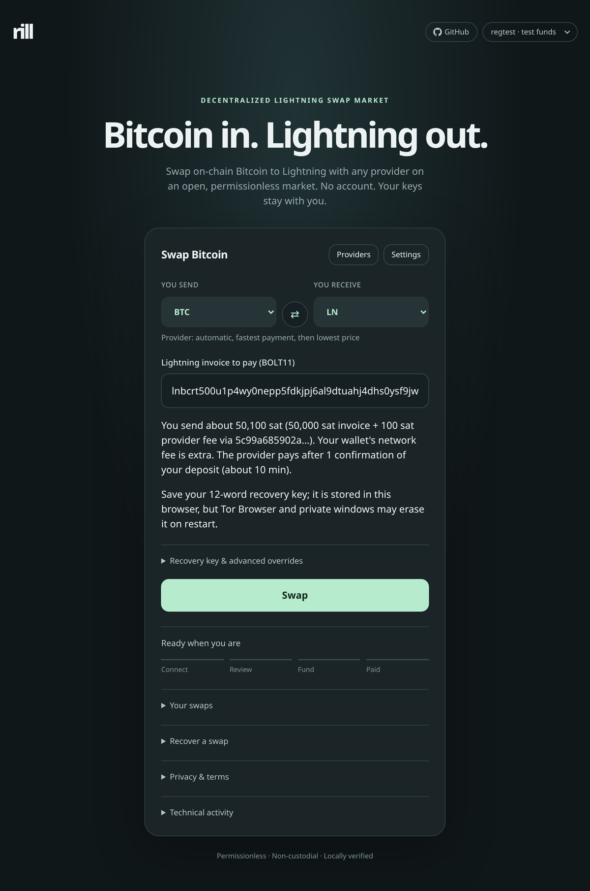
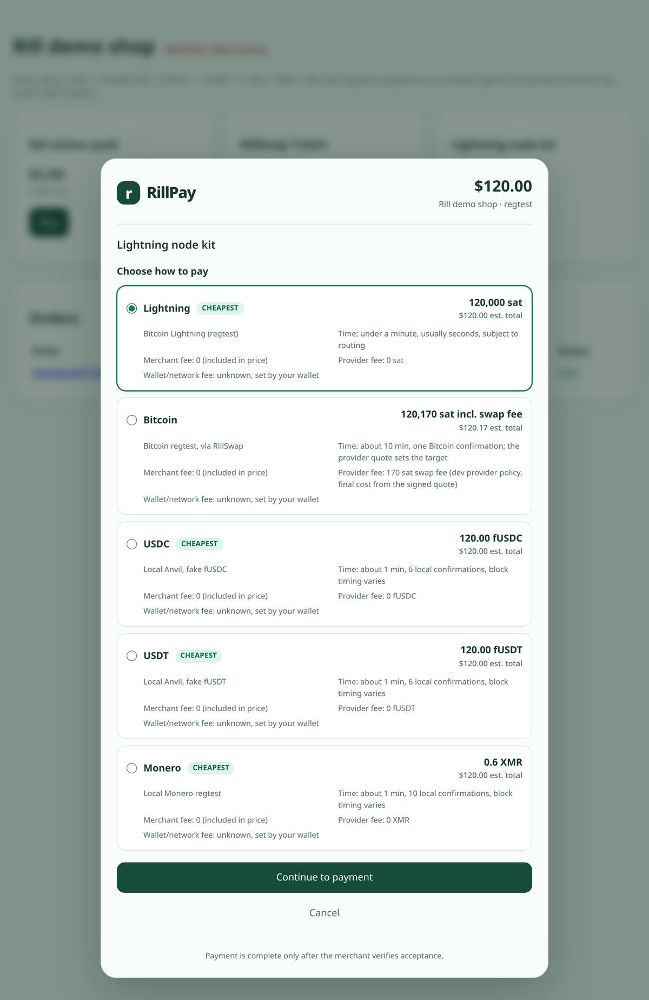

# RillSwap

**A decentralized, permissionless market for Lightning swaps. Non-custodial,
no account, verified on your device.**

RillSwap is an open atomic swap protocol and reference implementation. Anyone
can run a provider and join the market by publishing offers on Nostr, with no
registration or approval. You swap on-chain Bitcoin or ERC20 stablecoins for
Lightning payments (and back) with whichever provider you choose. Your client
verifies every contract, transaction and signature locally, and keeps an
encrypted recovery file so a failed swap can be refunded or claimed without
the provider, the website or any RillSwap service.

<table>
  <tr>
    <td width="50%"></td>
    <td width="50%"></td>
  </tr>
  <tr>
    <td align="center">Swap app: BTC to Lightning with any provider on the open market</td>
    <td align="center">RillPay merchant checkout (local demo shop, test assets)</td>
  </tr>
</table>

## Features

- **Four swap profiles.** BTC to Lightning, Lightning to BTC, USDC/USDT to
  Lightning and Lightning to USDC/USDT. Stablecoin swaps need a web build
  configured with pinned token and contract deployments; the published
  GitHub Pages build offers the Bitcoin profiles.
- **Atomic and non-custodial.** Bitcoin swaps lock funds in a two-leaf Taproot
  contract (hash-locked claim, time-locked refund); stablecoin swaps use the
  Boltz `ERC20Swap` hash-time-lock contract. A provider cannot take your funds
  without paying you, and if the swap fails you can refund after the timeout.
- **Private by default.** Bitcoin claims are cooperative MuSig2 key-path
  spends that look like ordinary Taproot payments, with a script-path
  fallback that never depends on the provider.
- **Independent recovery.** Encrypted [age](https://age-encryption.org)
  recovery files let the `rill` CLI refund or claim Bitcoin swaps with your
  own Bitcoin Core node. Stablecoin swaps are refunded or claimed from the
  browser wallet.
- **Permissionless discovery.** Providers publish signed offers on Nostr
  relays. There is no registry or allowlist, and all session traffic is
  end-to-end encrypted (NIP-44 inside NIP-59 gift wraps).
- **Browser client without a backend.** A static web app with bundled
  WebAssembly cryptography and no CDN or analytics, published to
  [GitHub Pages](https://rillswap.github.io/rillswap/) (signet at
  [`/signet/`](https://rillswap.github.io/rillswap/signet/)) or served from
  localhost.
- **Gas-sponsored stablecoin claims.** Receive USDC/USDT at a fresh address
  that holds no ETH, through an EIP-7702 / ERC-4337 sponsor that the browser
  verifies but does not trust.
- **Merchant checkout.** The RillPay checkout dialog and a merchant server
  that issues Lightning invoices from your own LND node and signs payment
  acceptances. Buyers can pay over Lightning or with on-chain BTC through a
  swap. The demo shop also shows local stablecoin and Monero rails.

## Try it locally

The fastest way to see everything working is the Docker Compose regtest
environment: Bitcoin Core, LND nodes, a Nostr relay, makers for all four swap
profiles, an Anvil EVM chain with test stablecoins, the browser app and a demo
shop. You only need Docker with Compose v2.

```sh
git clone https://github.com/rillswap/rillswap.git
cd rillswap
dev/devctl up      # build and start the stack (first run takes a few minutes)
dev/devctl smoke   # swap in both directions and pay the demo shop every way
```

Then open:

- Swap app: http://127.0.0.1:5273/swap.html
- Demo shop: http://127.0.0.1:8090/

Swap from the command line with `dev/devctl swap btc-to-ln 50000` or
`dev/devctl swap ln-to-btc 50000`. See [DEVELOPMENT.md](DEVELOPMENT.md) for a
walkthrough of every flow, all `devctl` commands and troubleshooting.

## How it works

1. A provider (maker) publishes a signed announcement with its terms on Nostr
   relays.
2. Your client discovers providers, opens an encrypted session with one and
   requests firm, signed terms.
3. Before you commit funds, the client rebuilds the swap contract from the
   terms, checks every amount, key and timeout, and saves an encrypted
   recovery file.
4. The swap settles atomically: the Lightning payment preimage unlocks the
   on-chain funds. If the provider disappears, the timeout path refunds you.

The protocol is specified in [`rill-docs/specs/`](rill-docs/specs/), with JSON
schemas and byte-level test vectors. [ARCHITECTURE.md](rill-docs/ARCHITECTURE.md)
explains the design, state machines and security invariants.

## Components

| Directory | Language | What it is |
| --- | --- | --- |
| [`rill-web`](rill-web/) | TypeScript | Static browser swap client and SDK |
| [`rill-cli`](rill-cli/) | Python | `rill` command-line client and independent recovery tool |
| [`rill-provider`](rill-provider/) | Python | `rill-provider` liquidity provider daemon (Bitcoin Core, LND, Nostr, EVM) |
| [`rill-payments`](rill-payments/) | TypeScript | Merchant checkout SDK, merchant ledger and services |
| [`rill-core`](rill-core/) | Python | Protocol types, validation, Taproot contracts and recovery primitives |
| [`rill-crypto`](rill-crypto/) | C, Python, WASM | Minimal binding to libsecp256k1 (Schnorr, MuSig2) for Python and the browser |
| [`rill-contracts`](rill-contracts/) | Solidity | Pinned EVM contract sources and compiled artifacts |
| [`rill-docs`](rill-docs/) | Markdown, JSON | Specifications, schemas, test vectors, BIP/NIP drafts |
| [`dev`](dev/) | Docker | Local regtest environment (`dev/devctl`) |

Each component has its own README with usage, configuration and test
commands. To run your own provider, use the published
`ghcr.io/rillswap/rill-provider` image and its Docker Compose setup
([rill-provider/README.md](rill-provider/README.md#docker)).

## Project status

| Network | Status |
| --- | --- |
| Regtest | Used by the development stack and end-to-end tests |
| Signet, testnet4 | Supported test networks |
| Mainnet | Supported. RillSwap is new software: start with small amounts |

See the [architecture](rill-docs/ARCHITECTURE.md) for the protocol design,
state machines and security invariants.

## Development

CI runs the specification conformance suite and each component's checks
(`.github/workflows/`). To run them locally, set up a component's environment
as described in its README, then run its tests from that directory, for
example:

```sh
(cd rill-core && .venv/bin/pytest -q)
(cd rill-web && bun test unit && bun run test)
```

Install the repository hooks with [prek](https://github.com/j178/prek) (or
pre-commit) and run `prek run --all-files` before committing. See
[CONTRIBUTING.md](CONTRIBUTING.md) for the contribution rules.

## Security

Please report vulnerabilities privately through
[GitHub private vulnerability reporting](https://github.com/rillswap/rillswap/security/advisories/new).
See [SECURITY.md](SECURITY.md).

## License

RillSwap is released under the [MIT license](LICENSE). Third-party files keep
their own licenses and are marked where they live:

- `rill-contracts/vendor/boltz-core/`: Boltz `ERC20Swap.sol` (MIT) and Uniswap
  `TransferHelper.sol` (GPL-3.0-or-later), compiled into
  `rill-contracts/artifacts/erc20-swap-v6.json`.
- Development stack account abstraction artifacts: `entry-point-v0.7.json`
  (GPL-3.0), `execution-install-delegate.json` and `sma7702.json`
  (GPL-3.0-or-later).

The GPL text is in `rill-contracts/licenses/GPL-3.0.txt`, and each artifact
records its upstream source.
